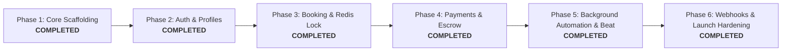

# Engineering Delivery Roadmap & Progress Tracking

## Temporary Eskom / Power Guard frontend shutdown (2026-10-14)

- **Start:** Began on shared `develop` checkout; frontend-only scope confirmed. No branch/worktree was created and no Railway/provider action was taken.
- **Checkpoint:** Added the reversible `POWER_GUARD_UI_ENABLED` flag (currently `false`) and removed the exposed teacher Power Guard route/dashboard surfaces, classroom Eskom report controls, admin status pill, and public Eskom/Power Guard marketing/refund copy. Generic tutor backup-power eligibility fields and badges remain unchanged.
- **Stop:** Focused frontend tests passed (262/262), TypeScript passed, and ESLint passed with zero warnings after the Rules-of-Hooks review. `npm run build` remains unverified because of ERR-525 (Google Fonts DNS failure followed by existing `.next` permission error). No Railway/provider state was accessed or changed.

## Current implementation progress — rate-limit and request-efficiency hardening (2026-10-14)

- **Branch:** `develop` shared checkout; no worktree or separate branch used.
- **Exact revision:** `dcaa9c7b92156e5e08d89ce550b08c26e09127aa` (`Add resilient rate limiting and request controls`), with local `HEAD` and the local `origin/develop` ref aligned.
- **Implemented:** targeted DRF/Redis scopes for public teacher slots, booking writes, purchase-status polling, financial reads/exports/documents, selected lesson/student/teacher/integration/admin/refund/CRM mutations, and private asset downloads.
- **Implemented:** explicit scopes for public teacher/material directories and details, credit-pack listing, and student/admin refund lists; cheap bounded catalog reads fail open on Redis outage, while sensitive/state-changing/unknown scopes fail closed with a controlled 503.
- **Implemented:** application-wide resilient wrappers for default anonymous/user throttles, older scoped throttles, and hashed login/reset-target throttles; existing identity hashing and rate behavior are preserved while Redis failures follow the same controlled policy.
- **Implemented:** bounded five-minute HMAC-keyed abuse counters with once-per-window escalation events; no raw identifiers, request bodies, IPs, tokens, or secrets are stored or logged.
- **Implemented:** bounded purchase-status polling with exponential backoff, visibility pause/resume, abort cancellation, a two-minute/eight-attempt cap, and bounded `Retry-After` handling.
- **Tests added:** focused backend scope/enforcement/observability tests and frontend polling/Retry-After tests.
- **Provider state:** superseded by the hosted release checkpoint below. The canonical isolated project `sharon-online-prod` (`e2b11747-5519-4139-bd34-a658affea42a`) now has API, worker, and Beat services deployed on the exact approved SHA; no development Redis or credentials were reused. The API is reachable at `https://api.topteacheracademy.com` and its public health endpoint is green.
- **Verification status:** local focused tests and static checks remain recorded below; hosted API and frontend checks are now also verified. Production migration application, Neon backup/restore evidence, and full authenticated browser-to-database acceptance remain separate and deliberately open.

## 1. 6-Phase Delivery Roadmap

| Phase | Milestone Description | Target Window | Status | Owner / Assignee |
| :--- | :--- | :--- | :--- | :--- |
| **Phase 1** | Monorepo scaffolding, Django 5.1 REST API + Next.js 14 setup, Postgres models, initial migrations & test suite | Sept 2026 | `COMPLETED` | Anesu MUPESA / Antigravity |
| **Phase 2** | JWT Authentication, User Roles (Student/Teacher/Admin), Profile Management, IANA Timezone Engine | Oct 2026 | `COMPLETED` | Anesu MUPESA / AI Agents |
| **Phase 3** | Redlock 10-Min Reservation Lock, Slot Availability Projection, Zoom S2S OAuth Meeting Generation, Google Calendar API | Oct 2026 | `COMPLETED` | Anesu MUPESA / AI Agents |
| **Phase 4** | PayFast (ZAR) Webhooks, PayPal v2 Orders (USD), Multi-Currency Ledger, Monthly Batch Payout Engine | Oct 2026 | `COMPLETED` | Anesu MUPESA / AI Agents |
| **Phase 5** | Background Automation & Celery Beat Workers (8 automated schedules, distributed locks, no-show adjudication, 24h escrow clearance, memo SLA) | Nov 2026 | `COMPLETED` | Anesu MUPESA / AI Agents |
| **Phase 6** | Zoom Attendance Webhook HMAC Ingestion, Cloudflare R2 Asset Delivery, E2E Staging & Production Launch | Nov 2026 | `COMPLETED` | Anesu MUPESA / AI Agents |

---

## 2. Component Implementation Progress Matrix

### 2.1 Backend Services (`Project-files/backend/`)
- [x] Django 5.1 & DRF Monorepo Structure
- [x] `apps.users`, `apps.teachers`, `apps.materials`, `apps.bookings`, `apps.payments`, `apps.crm`, `apps.admin_api`, `apps.srs` schema models
- [x] PostgreSQL database migrations applied cleanly
- [x] `seed_data` and `seed_phase41_data` initialized
- [x] `pytest` suite configured (59/59 automated unit, concurrency, webhook & double-entry ledger integration tests passing)
- [x] Health check endpoint (`GET /api/health/`)
- [x] JWT Auth endpoints (`/api/v1/auth/token/`, `/api/v1/auth/register/`)
- [x] Redis Redlock reservation engine (`SET booking:slot:... NX EX 600`)
- [x] Zoom S2S OAuth Client & Asynchronous Meeting Provisioning
- [x] PayFast ITN & PayPal Webhook Handlers (`process_payment_webhook`) with DEF-501 Concurrency Guard (late payment quarantine & wallet restitution)
- [x] Zoom Webhook Ingestion Receiver (`ZoomWebhookReceiverView`) with timing-safe HMAC verification, CRC challenge response, replay attack prevention, and attendance telemetry
- [x] Late Webhook Concurrency Guard (Active Zoom probe at T+10m, transactional row locks, out-of-order session keying, and dispute quarantine)
- [x] Celery Beat Background Automation (8 scheduled tasks, `@distributed_task_lock`, multi-queue routing)
- [*] See comprehensive breakdown in [`docs/MASTER_MODULE_ROADMAP_AND_ARCHITECTURE.md`](./MASTER_MODULE_ROADMAP_AND_ARCHITECTURE.md)

### 2.2 Frontend Services (`Project-files/frontend/`)
- [x] Next.js 14 App Router (TypeScript, Tailwind CSS)
- [x] 12/12 Static and Dynamic Route build compilation (`npm run build` succeeds)
- [x] UI Vertical Slicing Migration Plan formulated & documented (`docs/UI_VERTICAL_SLICE_MIGRATION_PLAN.md`)
- [x] **Slice 1 Completed**: Public Marketing & Discovery Suite (`/`, `/pricing`, `/how-it-works`, `/trust-safety`, `/teach`, `/support`, `/tutors`, `/materials`)
- [x] Multi-Currency Display Engine (USD, ZAR, EUR, JPY) with auto-detection & localStorage persistence
- [x] EskomSePush Power Guard Resilience Callout & 24-Hour Escrow Trust Badges
- [x] **Slice 2 Completed**: Authentication & Multi-Role Session Provider
  - [x] `src/context/AuthContext.tsx` with JWT tokens, session hydration & offline demo sandboxes
  - [x] `src/middleware.ts` Next.js Edge Middleware with RBAC protection (`/student/*`, `/teacher/*`, `/admin/*`)
  - [x] `src/lib/auth.ts` cookie synchronization (`sharon_access_token`, `sharon_user_role`)
  - [x] Upgraded `/login` (supporting email/username, `?next=` redirection & 1-click sandbox profiles)
  - [x] Upgraded `/register` (dual student / tutor audition funnel with Eskom backup confirmation)
  - [x] Created `/forgot-password` recovery link dispatch
  - [x] Auth-aware `Navbar` with dynamic user profile, credit tracker, and 1-click sign-out
- [x] **Slice 3 Completed**: Tutor Directory, Faceted Filtering & Public Profile
  - [x] `src/types/tutor.ts` detailed `PublicTutor`, `TutorFilterState`, `TutorReview` data contracts
  - [x] `src/components/tutors/TutorCard.tsx` magazine card layout with accent tag & next slot badge
  - [x] `src/components/tutors/TutorFilters.tsx` faceted filtering (accent, focus, max price, power guard, today)
  - [x] `src/components/tutors/TutorGrid.tsx` 3-column responsive grid with loading skeletons & empty state
  - [x] `src/components/tutors/VideoReelPlayer.tsx` 60s video player with custom play overlay & poster
  - [x] `src/components/tutors/AudioSnippetButton.tsx` 15s accent audition player
  - [x] `src/components/tutors/TutorReviewList.tsx` verified student reviews & rating breakdown
  - [x] `src/components/tutors/InlineSlotMatrix.tsx` 7-day schedule grid with timezone translation
  - [x] `/tutors` filterable directory with URL state sync
  - [x] `/tutors/[id]` full tutor showcase, video audition & schedule matrix
- [x] **Slice 4 Completed**: 10-Minute Redis Reservation Engine & Multi-Currency Checkout
  - [x] `src/types/booking.ts` strongly-typed data contracts for slots, holds, bookings, and ledger
  - [x] `src/components/booking/SlotGrid.tsx` 25-minute discrete slots grouped by time of day
  - [x] `src/components/booking/TimezoneSelector.tsx` instant student viewer timezone switch
  - [x] `src/components/booking/ReservationTimer.tsx` animated 10:00 -> 00:00 countdown timer with expiry modal
  - [x] `src/components/booking/PayFastForm.tsx` South African ZAR instant EFT and bank card gateway
  - [x] `src/components/booking/PayPalButtonsWrapper.tsx` international multi-currency gateway (USD/EUR/JPY)
  - [x] `/student/book/[tutorId]` 14-day rolling schedule and 1-click slot reservation
  - [x] `/student/checkout/[bookingId]` dual checkout (1-click credit redemption vs PayFast/PayPal)
  - [x] `/student/confirmed/[bookingId]` celebration screen with Google Calendar link, .ICS download & Zoom link
  - [x] `/student/wallet` credit balance tracker, bundle pack top-up, and full transaction ledger
- [x] **Slice 5 Completed**: Curriculum Catalog & Interactive Lesson Reader
  - [x] `src/types/material.ts` strong CEFR (`A1` to `C2`), `MaterialCategory`, and `VocabularyItem` data contracts
  - [x] `src/components/materials/CefrLevelBadge.tsx` color-coded CEFR badges (Mint A1/A2, Teal B1/B2, Plum C1, Gold C2)
  - [x] `src/components/materials/MaterialCategoryTabs.tsx` category pill filters (Daily News, Business, FreeTalk, Test Prep)
  - [x] `src/components/materials/InteractiveWordTooltip.tsx` click popover with pronunciation audio, definition & student bank save
  - [x] `src/components/materials/DiscussionSection.tsx` debate prompts with tutor guidance callouts
  - [x] `src/components/materials/SplitScreenReader.tsx` dual-embed reader widget with font scaling & tab toggling for Slice 6
  - [x] `/materials` filterable catalog with live search debounce, category pills, CEFR badges, and direct links
  - [x] `/materials/[slug]` full interactive lesson reader with high-readability serif typography, vocabulary bank & Cloudflare R2 PDF download trigger
- [x] **Slice 6 Completed**: Live Classroom Staging & Zoom Embed Pad
  - [x] `src/components/classroom/HardwareCheckModal.tsx` WebRTC AV media stream tester with live video preview, dynamic 16-segment mic volume bar & synthetic speaker test chime
  - [x] `src/components/classroom/ZoomLauncherButton.tsx` dual launcher supporting Zoom desktop app deep links (`zoommtg://`), mobile protocols (`zoomus://`), web client fallbacks & credential clipboard copy
  - [x] `src/components/classroom/LessonCountDownClock.tsx` synchronous 25-minute lesson clock (pre-lesson staging window, in-progress countdown, wrap-up alert, and completion state)
  - [x] `src/components/classroom/EskomReportButton.tsx` Eskom load shedding panic button with student credit auto-refund and tutor penalty waiver
  - [x] `src/components/classroom/ClassroomSplitLayout.tsx` 50/50 dual-pane layout toggle (split, video focus, material focus)
  - [x] `/student/classroom/[id]` student staging room with tutor profile, checklist, AV tester, Zoom launcher, and synchronized material reader
  - [x] `/teacher/classroom/[id]` tutor cockpit with student learning dossier, in-lesson scratchpad, host Zoom launcher, and post-lesson memo transition
- [x] **Slice 7 Completed**: Tutor Operations & Eskom Power Guard
  - [x] `src/types/teacher.ts` data contracts for `EskomStatus`, `PostLessonMemoInput`, `TeacherWalletData`, `TeacherPayoutBankAccount`
  - [x] `src/components/teacher/EskomStageBanner.tsx` alert banner monitoring Eskom stage and battery backup protection
  - [x] `src/components/teacher/WeeklyScheduleGrid.tsx` 7-day recurring availability matrix with quick presets (Business, Evening, Clear, Copy Monday)
  - [x] `src/components/teacher/MemoComposer.tsx` post-lesson evaluation studio with vocabulary tag builder, pronunciation notes, grammar slip corrections & homework assignments
  - [x] `src/components/teacher/EarningsBreakdownCard.tsx` ZAR clearing ledger cards with 80% net tutor share translation ($6.40 × 18.75 = R120.00)
  - [x] `/teacher/dashboard` upgraded operations cockpit with live Eskom status, next class staging hero, and pending memo alerts
  - [x] `/teacher/schedule` weekly availability planner in SAST with zero-drift global timezone projection
  - [x] `/teacher/power-guard` Eskom Power Guard console with suburb block selector, live stage monitor, inverter certification, and LTE failover toggle
  - [x] `/teacher/bookings/[id]/memo` post-lesson memo studio linking directly from completed sessions
  - [x] `/teacher/wallet` earnings wallet with pending escrow, cleared ZAR balance, transaction history, and verified payout account summary
  - [x] `/teacher/wallet/payout-settings` South African EFT bank details form with 6-digit universal branch code validator (Capitec, FNB, Standard Bank, Nedbank, Absa)
  - [x] `/teacher/profile` tutor public profile editor (bio, accent, 60s video reel URL, hourly rate, specialties)
- [x] **Slice 8 Completed**: Admin Advanced Command Center
  - [x] `src/types/admin.ts` data contracts for `AdminTelemetry`, `PendingTeacherApplication`, `LiveSessionRadarItem`, `DisputeCase`, `FinanceEscrowItem`, `PayoutBatchItem`
  - [x] `src/app/admin/layout.tsx` executive command layout with dark plum sidebar, live telemetry indicators, and navigation badges
  - [x] `/admin/dashboard` multi-currency KPI grid (GMV today, MTD volume, active Zoom classes, open disputes, escrow holding balance)
  - [x] `/admin/teachers/vetting` tutor audition studio with 60s video player, TEFL certificate inspection, Eskom battery declaration, and 1-click Approve/Reject
  - [x] `/admin/teachers` tutor roster directory with quality telemetry, verification status, and profile links
  - [x] `/admin/sessions/live` live attendance radar monitoring real-time participant dwell time, entry/exit timestamps, and Zoom meeting IDs
  - [x] `/admin/disputes` dispute arbitration tribunal with side-by-side student vs tutor evidence against Zoom server logs and atomic 1-click refunds
  - [x] `/admin/finance/ledger` double-entry escrow liability audit with 24-hour clearance tracking and platform take rate
  - [x] `/admin/finance/payouts` South African ACB / EFT bank batch payout orchestrator with verified CSV generation and instant batch settlement
  - [x] `/admin/disputes` dispute arbitration tribunal with side-by-side student vs tutor evidence against Zoom server logs and atomic 1-click refunds
- [x] **Slice 9 Completed**: Student Learning Hub, Spaced Repetition Flashcards & Post-Lesson Review Suite
  - [x] `src/types/student.ts` data contracts for `StudentLessonItem`, `StudentFlashcard`, `StudentProfileData`, `TeacherStudentDossierItem`
  - [x] `src/components/student/FlashcardDeck.tsx` 3D perspective flip card with Web Speech API audio pronunciation, SRS intervals (`Again` <1d, `Good` 3d, `Easy` 7d), deck shuffle, and session stats
  - [x] `src/components/student/LessonMemoModal.tsx` completed lesson memo inspector with tutor feedback, synchronized vocabulary badges, pronunciation hints, grammar notes, and print/copy options
  - [x] `src/components/student/ReviewRubricModal.tsx` 5-star rubric review with category tags, constructive private feedback, and asymmetric privacy guarantee
  - [x] `/student/dashboard` upgraded command center with lesson staging links, credits balance, SRS vocabulary preview, and memo access
  - [x] `/student/history` complete lesson archive with status filtering (all, completed, interrupted/refunded) and search
  - [x] `/student/vocabulary` interactive study hub with flashcard deck and searchable word bank table
  - [x] `/student/bookings/[id]/review` standalone 5-star rubric review page
  - [x] `/student/profile` student profile manager with IANA timezone selector, CEFR target level, and learning goals
  - [x] `/teacher/students` tutor private pedagogical CRM dossier with student roster, grammar slip tracking, and private pedagogical notes
  - [x] Complete UI Vertical Slice Architecture (`Slices 0 through 9`) Fully Delivered & Production Compiled (34/34 -> 40/40 routes)
- [x] **Slice 10 Completed**: Production Hardening, Multi-Container Docker Orchestration, End-to-End Testing & Critical Path Validation
  - [x] `tests/test_concurrency_stress.py` 50-worker concurrent lock contention stress test proving Redlock mutual exclusion, multi-slot isolation, and unauthorized release rejection
  - [x] `tests/test_e2e_booking_lifecycle.py` complete happy-path lifecycle test (tutor SAST to student JST slot generation, Redlock hold, PayPal/PayFast webhook idempotency, Celery Zoom S2S OAuth meeting generation, lesson progression, post-lesson memo, 5-star rubric review, and Eskom outage refund)
  - [x] `tests/test_api_endpoints.py` API health check (`/api/health/`), materials catalog, and tutor directory verification
  - [x] `apps/bookings/views.py` & `urls.py` implemented `ReportOutageView` (`POST /api/v1/bookings/<id>/report-outage/`) with automated student credit refund and tutor penalty waiver
  - [x] `apps/bookings/models.py` updated with `INTERRUPTED_POWER` choice and applied migration `0003_alter_booking_status.py`
  - [x] `docker-compose.yml` updated with `celery_beat` periodic task scheduler alongside `db`, `redis`, `backend`, `celery`, and `frontend`
  - [x] 100% Backend Automated Test Suite Pass Rate (12/12 `pytest` tests clean)
  - [x] 100% Frontend Production Build Pass Rate (40/40 routes `npm run build` clean)
- [x] **Phase 4.1 Completed**: Backend API Bridge for Admin Command Center, Teacher CRM & Student SRS
  - [x] Created `apps.admin_api`: Telemetry aggregator (`/api/v1/admin/telemetry/`), Tutor vetting pipeline (`/api/v1/admin/teachers/pending-vetting/` & `.../verify/`), Live attendance radar (`/api/v1/admin/attendance/live/`), Dispute tribunal with platform-absorbed 50/50 resolution (`/api/v1/admin/disputes/`), Escrow ledger audit (`/api/v1/admin/finance/ledger/`), and South African ACB / EFT payout batch orchestrator (`/api/v1/admin/payouts/batch/` & `.../execute-batch/`).
  - [x] Created `apps.crm`: `StudentTutorDossier` model with strict role isolation (`/api/v1/teacher/students/` & `.../<id>/dossier/`) protecting confidential pedagogical notes and common grammar mistake tracking.
  - [x] Created `apps.srs`: `StudentFlashcard` model with 1/3/7-day Leitner progression (`/api/v1/student/flashcards/` & `.../<id>/mastery/`), lesson archive with attached memos (`/api/v1/student/lessons/`), 5-star rubric review submission (`/api/v1/student/bookings/<id>/review/`), and student profile management (`/api/v1/student/profile/`).
  - [x] Automated Memo-to-Flashcard Ingestion Pipeline: `SubmitMemoView` automatically converts vocabulary words into student flashcards with initial due dates.
  - [x] Built comprehensive seed data management command `seed_phase41_data.py`.
  - [x] 100% Automated Backend Test Suite Pass Rate (26/26 `pytest` tests clean across all modules, including RBAC authorization boundaries, dispute settlements, and cross-student isolation).
  - [x] 100% Frontend Production Build Pass Rate (33/33 production routes and Edge Middleware compiled cleanly with 0 TypeScript/lint errors).
  - [x] Independent Dual Audit Sign-Off: Approved with Commendation by Senior Systems Architect and Lead QA Automation Engineer.
- [x] **Phase 5 Completed**: Background Automation & Celery Beat Workers
  - [x] Created `backend/config/celery_schedule.py`: Configured 8 periodic beat schedules with multi-queue routing (`scheduler_beat`, `financial_escrow`, `notifications`, `critical_io`) and task expiration windows.
  - [x] Created `backend/apps/common/locks.py`: Implemented `@distributed_task_lock` decorator utilizing atomic Redis caching (`SET NX`) guaranteeing single-worker execution across clustered environments.
  - [x] Enhanced `Booking`, `TeacherProfile`, and `PaymentTransaction` models with background automation tracking flags, SLA reliability strike counters, Eskom resilience settings, and database constraints.
  - [x] Created `apps/bookings/tasks.py`:
    - `purge_expired_reservations_task`: 60-second abandoned checkout reaper releasing Redis pessimistic slot locks.
    - `audit_attendance_and_noshows_task`: 60-second live attendance radar, T+5m tutor late alerts, T+10m automated no-show adjudication (`TEACHER_NO_SHOW` with 100% refund + 1 bonus credit vs `STUDENT_NO_SHOW` with tutor payout), and T+25m completion verification (>=20m attendance).
    - `dispatch_pre_lesson_reminders_task`: 5-minute pre-lesson reminder dispatch (T-24h calendar check, T-1h AV test, T-10m Zoom launch link).
    - `enforce_memo_sla_task`: 15-minute memo SLA engine (T+12h reminder warning; T+24h memo auto-forfeiture, tutor strike, admin ticket, and student apology credit).
  - [x] Created `apps/payments/tasks.py`:
    - `release_cleared_escrow_task`: 15-minute dual-verified 24h escrow clearance engine (verifying attendance >= 20m, absence of open disputes, and 80/20 tutor net split).
    - `reconcile_pending_transactions_task`: Hourly reconciliation of abandoned payment sessions.
  - [x] Updated `apps/integrations/tasks.py`:
    - `sync_eskom_stages_task`: 15-minute EskomSePush stage caching and proactive outage shield for confirmed lessons in the next 4 hours.
    - `reconcile_teacher_gcal_task`: 30-minute 2-way Google Calendar free/busy reconciliation.
  - [x] Created `tests/test_celery_beat_automation.py`: 13 comprehensive automated unit & integration tests validating all pipelines, time-travel, and concurrency locks.
  - [x] 100% Automated Backend Test Suite Pass Rate (39/39 `pytest` tests clean across all modules).

---

## 3. Master 46-View Page Inventory Tracker

| View ID | Path / Route | View Name | Status |
| :--- | :--- | :--- | :--- |
| `PUB-01` | `/` | Global Marketing Homepage | `Built (Static)` |
| `PUB-02` | `/tutors` | Tutor Discovery & Search Engine | `Built (Static)` |
| `PUB-03` | `/tutors/[slug]` | Tutor Profile & Video Reel | `Built (Static)` |
| `PUB-04` | `/materials` | Interactive Curriculum Catalog | `Built (Static)` |
| `PUB-05` | `/materials/[slug]` | Material Content Reader | `Built (Dynamic)` |
| `PUB-06` | `/pricing` | Geo-Localized Pricing & Plans | `Built (Static)` |
| `STU-01` | `/student/dashboard` | Student Command Dashboard | `Built (Static)` |
| `STU-02` | `/student/book/[tutorId]` | Booking Matrix | `Built (Dynamic)` |
| `STU-03` | `/student/checkout/[id]` | Multi-Currency Checkout | `Built (Dynamic)` |
| `STU-04` | `/student/wallet` | Credit Balance & Ledger | `Built (Static)` |
| `STU-05` | `/student/classroom/[id]` | Student Classroom Staging Pad | `Built (Dynamic)` |
| `STU-06` | `/student/history` | Completed Lessons & Memos | `Built (Static)` |
| `STU-07` | `/student/vocabulary` | Spaced Repetition Flashcards | `Built (Static)` |
| `STU-08` | `/student/bookings/[id]/review` | 5-Star Lesson Rubric Review | `Built (Dynamic)` |
| `STU-09` | `/student/profile` | Student Profile & Timezone | `Built (Static)` |
| `TEA-01` | `/teacher/profile` | Tutor Public Profile Editor | `Built (Static)` |
| `TEA-02` | `/teacher/dashboard` | Tutor Operations Dashboard | `Built (Static)` |
| `TEA-03` | `/teacher/schedule` | Availability & Calendar Sync | `Built (Static)` |
| `TEA-04` | `/teacher/classroom/[id]` | Tutor Classroom Cockpit Pad | `Built (Dynamic)` |
| `TEA-05` | `/teacher/bookings/[id]/memo` | Post-Lesson Memo Studio | `Built (Dynamic)` |
| `TEA-06` | `/teacher/wallet` | Tutor Earnings & ZAR Wallet | `Built (Static)` |
| `TEA-07` | `/teacher/wallet/payout-settings`| SA EFT Payout Bank Settings | `Built (Static)` |
| `TEA-08` | `/teacher/students` | Tutor Private Student CRM Dossier | `Built (Static)` |
| `TEA-09` | `/teacher/power-guard` | Eskom Power Guard Console | `Built (Static)` |
| `ADM-01` | `/admin/dashboard` | Global Operations Dashboard | `Built (Static)` |
| `ADM-02` | `/admin/teachers/vetting` | Tutor Video Audition Studio | `Built (Static)` |
| `ADM-03` | `/admin/teachers` | Tutor Roster & Telemetry | `Built (Static)` |
| `ADM-04` | `/admin/sessions/live` | Live Attendance Radar | `Built (Static)` |
| `ADM-05` | `/admin/finance/ledger` | Multi-Currency Escrow Audit | `Built (Static)` |
| `ADM-06` | `/admin/finance/payouts` | Bank Batch Payout Orchestrator | `Built (Static)` |
| `ADM-07` | `/admin/disputes` | Dispute Arbitration Tribunal | `Built (Static)` |

---

## 4. Current Active Sprint Backlog (Sprint 6: Launch Hardening)

- [x] **Task 6.1**: Implement Zoom Webhook Ingestion Receiver (`ZoomWebhookReceiverView` in `apps.integrations`) validating HMAC-SHA256 signature (`x-zm-signature`), CRC challenge handshake, replay guard, and populating `AttendanceAudit`.
- [x] **Task 6.2**: Implement Late Webhook Concurrency Guard (Active Zoom probe at T+10m, `select_for_update` DB row locks, out-of-order session keying, and late webhook dispute quarantine in `apps.integrations` & `apps.bookings`).
- [x] **DEF-501 Fix**: Payment Gateway Concurrency Guard in `apps/payments/services/webhook_handler.py` resolving collision when late payments arrive on expired/re-booked slots (auto-quarantines to `DISPUTED`, awards 1 lesson credit restitution, opens `DisputeCase`, preventing `IntegrityError` 500s).
- [x] **Task 6.3**: Formalize double-entry transaction journal table (`LedgerEntry` debit/credit rows with strict zero-sum balancing, SARB/SARS ZAR conversion, and GAAP Chart of Accounts) in `apps.payments.models`, `apps.payments.services.ledger_service`, webhook handlers, Celery escrow tasks, dispute tribunal, and payout orchestrator.
  - *GAAP Chart of Accounts*: Assets (`1010` PayFast, `1020` PayPal, `1030` Operating Bank), Liabilities (`2010` Escrow Trust, `2020` Tutor Payable, `2030` DEF-501 Quarantine, `2040` Student Wallet Credits), Revenue (`4010` Platform Commission 20%), Expenses (`5010` Dispute Subsidies, `5020` Student Compensation, `5030` Gateway Fees, `5040` Platform-Absorbed Payment Failure (added Task 10.2e)).
  - *Strict Immutability*: Prohibits UPDATE/DELETE operations via `LedgerEntryQuerySet` and model-level `save()` / `delete()` overrides raising `LedgerImmutabilityError`.
  - *Lifecycle Balancing Hooks*: Captures, clearances, gateway/wallet refunds, dispute tribunal splits (50/50 platform absorption), and EFT payout disbursements.
  - *Live Admin Telemetry*: `GET /api/v1/admin/finance/ledger/` queries `LedgerEntry` directly for live gateway balances, pending escrow, tutor liabilities, and net revenue with zero-sum trial balance validation.
- [x] **Task 6.4**: Connect Cloudflare R2 bucket integration for static curriculum PDFs, tutor audio audition samples, and profile avatars with zero egress fees.
  - *Custom Storage Backends*: Implemented `MediaR2Storage` (Tier 1 public CDN edge delivery at `assets.sharonesl.com` with `default_acl = None` and `s3v4` signature) and `PrivateMediaR2Storage` (Tier 2 private regulated compliance vault with 15-minute presigned queries for private TEFL/ID vetting documents) in `apps.common.storage`.
  - *Client Helpers & Presigned Utilities*: Built `apps.common.r2_client` supporting `generate_presigned_download_url`, `generate_presigned_upload_url`, `get_public_r2_url`, with zero-drift local `MEDIA_URL` fallback for offline development.
  - *Model & Schema Enhancements*: Added `pdf_file`, `audio_snippet_file`, `audio_snippet_url` to `Material` and `avatar_image`, `intro_audio_file`, `intro_audio_url`, `tefl_certificate_file` to `TeacherProfile` with dynamic property resolution and Django admin upload fieldsets.
  - *Presigned Direct-to-Storage API Endpoints*: Exposed `PresignedUploadURLView` at `POST /api/v1/integrations/storage/presigned-url/` and `/api/v1/integrations/r2/presigned-url/` with role-based prefix enforcement (protecting teacher audio/avatar and private certificate namespaces), path traversal defense, and private vault download RBAC.
  - *Edge Domain Whitelisting*: Configured Next.js `images.remotePatterns` for `assets.sharonesl.com`, `*.r2.dev`, and `*.r2.cloudflarestorage.com`.
  - *Automated Test Suite*: Created `tests/test_r2_storage.py` (7/7 unit & RBAC tests passing; 74/74 total backend suite tests clean).
- [x] **Task 6.5**: Run end-to-end multi-container docker staging test (`docker compose up -d`) with full lifecycle verification. `[COMPLETED]`
  - *Container Cluster Orchestration*: Spun up all 6 interconnected Docker services (`esl_postgres` PostgreSQL 16 Alpine, `esl_redis` Redis 7 Alpine, `esl_backend` Django 5.1 REST API, `esl_celery` Celery 5.4 worker, `esl_celery_beat` Celery Beat periodic scheduler, and `esl_frontend` Next.js 14 App Router) with integrated health checks and graceful startup dependencies.
  - *Containerized Database Migrations & Seeding*: Applied all 35+ Django database migrations cleanly and executed `seed_data` + `seed_phase41_data` initializing base admin, Japanese student (`student_aiko`), verified tutor roster, CEFR materials, pending vetting applications, dispute cases, and Leitner flashcards.
  - *Containerized Test Execution*: Executed full automated test suite (`docker compose exec backend pytest`) passing 74/74 unit, integration, concurrency stress, double-entry ledger, and storage tests clean (100% pass rate in 29.9s).
  - *Live Endpoint & SSR Validation*: Verified live health check (`GET /api/health/`), JWT auth token issuance (`POST /api/v1/auth/token/`), teacher and material catalogs, admin telemetry radar, and multi-route Next.js server-side rendering (`/`, `/tutors`, `/materials`, `/pricing`, `/how-it-works`, `/trust-safety`) with zero connection errors.
  - *PostgreSQL Outer-Join Concurrency Fix (`ERR-004`)*: Resolved `FeatureNotSupported: FOR UPDATE cannot be applied to the nullable side of an outer join` in `release_cleared_escrow_task` using subquery exclusion and table-level `of=('self',)` row locks.
  - *Multi-Container Dual-Environment Routing (`ERR-005`, historical)*: Configured `INTERNAL_API_URL=http://backend:8000/api/v1` for server-side RSC/SSR container-to-container calls. The former localhost browser fallback is superseded by the server-only upstream boundary documented in the Vercel dual-environment working protocol.

---

## 5. Production Readiness Phases 7-16 (added 2026-10-02)

A four-way audit (backend, frontend, spec-vs-roadmap, infra) found that Phases 1-6 delivered a UI-complete, test-green skeleton, not a launched platform: payment webhooks are unauthenticated, checkout and payouts are stubs, the frontend silently falls back to mock data, and nothing is deployed. The full task list with IDs, owners, sizes and acceptance notes is in [`PRODUCTION_READINESS_PLAN.md`](PRODUCTION_READINESS_PLAN.md). Tick tasks off there **and** summarise each phase here as it closes.

| Phase | Theme | Status |
| :--- | :--- | :--- |
| **Phase 7** | Security emergency + spec freeze (decisions D-1..D-12) | `7A + 7B DONE (7.1-7.9, adversarial-review fixes; 220 tests); 7.10 + D-3,4,7-12 awaiting Anesu` |
| **Phase 8** | Honest frontend + real auth | `DONE - 8.1-8.9 + 9.2 done (honest client, HttpOnly cookie sessions via Next BFF proxy, signed-session middleware, real reserve->booking_id, password reset/change, e-mail verification, login by e-mail, Next 16 / React 19 upgrade)` |
| **Phase 9** | Booking core (`transition_booking()`, reserve → book) | `DONE (2026-10-03) - 9.1-9.10: state machine + audit trail, holds, slot grid, booking list, cancel / reschedule engine (D-6), settlement paths, verified Zoom attendance, memo, reviews; 876 backend + 93 frontend tests` |
| **Phase 10** | Real payments (PayPal/PayFast sandbox, credits, refunds, multi-currency ledger) | `NEXT - about half the groundwork exists (Codex remediation merged 2026-10-03: funding provenance, credit packs + redemption, FX snapshots, ledger trigger, CI). Plan: PHASE_10_EXECUTION_PLAN.md. Lesson price catalog + follow-ups done (10.1 A-D: no-float money, required ledger FX, frontend prices from API, EUR/JPY via admin FX table; prices provisional). PayPal orders, capture, grace bookings, webhook events and real buttons done in code 2026-10-04 (10.2/10.3, mocked HTTP; awaiting sandbox verification). Real refund gateways (10.7) done in code 2026-10-04 (PayPal refunds with claim/call/apply protocol, staff refund API, student "On its way" status, runbook; mocked HTTP, awaiting sandbox verification; PayFast refunds are a manual stub). [x] Receipts (10.8, 2026-10-06, Claude: `Receipt`, sequential INV numbers, owner-only PDF, docs/slices/T10_8.md). Remaining: Postgres payment suite (10.10), sandbox verification. Needs Anesu: PayPal sandbox credentials, pack expiry, currencies, FX source` |
| **Phase 11** | Tutor lifecycle + real payouts | `IN PROGRESS - plan: PHASE_11_12_EXECUTION_PLAN.md. [x] P1a-c payout batches (2026-10-06, Claude, docs/slices/P1.md + PAYOUTS_GO_LIVE.md; follow-ups the same day: e-mailed bank-change code, payout notices, P2 statement CSV, admin payout-runs screen, receipts list, event-preserving Google reschedule; batch/line/attempt models, one open line per tutor by constraint, maker-checker, re-checked bank fingerprint and balance, defused bank CSV with audit, atomic DR 2020 / CR 1030 posting, bank-return reversal; awaits D-3, a second admin, bank-change OTP, P2 statements and UI). [x] Q0 quality infrastructure (2026-10-04: guard tests with shrink-only baselines, ruff CI job, no-network fixture, provider fakes, factories, clock seam, mutate.py, migration helper; QUALITY_GATES.md). [x] T1a tutor status machine core = 11.1/11.4 PARTIAL (2026-10-04: TeacherProfile.status + GeneratedField is_verified/is_active, teachers/vetting.py transition_teacher with actor policy + TeacherStatusChange audit, migrations teachers 0007/0008 reversible, strikes suspend via the service, legacy verify endpoint as a shim, guard (a) allowlist empty; TUTOR_STATUS_MACHINE.md). [x] T1b = 11.1/11.4 PARTIAL (2026-10-05, branch feature/t1b-bookable-review: TeacherProfile.objects.bookable() + the twelve call sites incl. the payment-webhook quarantine, explicit staff review actions (start-review/approve/request-changes/reject/suspend/reactivate/revet/reopen) with the staff-only suspended -> rejected edge, legacy verify rebuilt on them (path-walking shim deleted), pending queue incl. applied, admin cancel of a suspended tutor's lessons (full refund, no strike) + work queue, review lock order booking -> tutor; TUTOR_TRAINING_GATE_ENABLED=False provisional, must be ON before launch).[x] T1c tutor profile at signup = 11.1 PARTIAL (2026-10-05, branch feature/t1c-tutor-profile: registration creates the applied profile through create_teacher_profile, teachers 0009 backfill (data only, reversible) + 0010 specialties blank, GET|PATCH /teachers/me// with a headline/bio/specialties whitelist and explicit update_fields, re-vet hook for T3, /auth/me tutor_status, admin pending-application serializer without the fake Eskom area, public price deprecated to the catalog price and ?max_price= removed; docs/slices/T1c.md). [x] T4a vetting backend = 11.4 PARTIAL (2026-10-05, branch feature/t4a-vetting-backend: approve needs a 4-criterion 1-5 rubric (VETTING_MIN_RUBRIC_SCORE, provisional D-11) and proof the reviewer saw the live uploads (reviewed_assets etags), request-changes stores the requested upload kinds, GET /admin/teachers/<id>/review-packet/ (staff only, no storage keys), /teachers/me/ review_feedback (reason + changes, never scores), staff alert when a tutor submits; the admin vetting page needs the T4b rubric form; TUTOR_STATUS_MACHINE.md section 12, docs/mutation/T4a.md). [x] T4b admin vetting studio UI = 11.4 PARTIAL (2026-10-06, Antigravity: /admin/teachers/vetting upgraded with review-packet inspector, 4-criterion 1-5 rubric scoring studio, min-12 threshold validation, reviewed_assets ETag mapping, start-review, approve, request-changes, reject actions; frontend 198 tests passing, lint 0 warnings, build clean; docs/slices/T4b.md). [x] V4 contract (2026-10-05: tests/test_v4_attendance_contract.py, bookings/services/video_provider.py, video_session_probe.py seam, zoom step skipped for Video SDK lessons; V4 implementation is Antigravity's, docs/slices/V4-contract.md). [x] T6 training infrastructure = 11.5 PARTIAL (2026-10-05: TrainingModule/TrainingProgress (teachers 0013), teachers/training.py completion service (training_completed_at set once when every published required module is done), GET /teachers/me/training/ + detail + complete, Django admin for Sharon's content, `manage.py backfill_training_completed` before enabling the gate; content is Sharon's; docs/mutation/T6.md). [x] T5a application funnel backend = 11.2 PARTIAL (2026-10-05: TeacherApplication (teachers 0014), GET|PATCH /teachers/me/application/ with five steps (profile, uploads, power backup, speed test 10/5 Mbps, declaration; provisional D-11), POST .../submit/ by the tutor (staff alert), the staff lead-in and the `applied` queue entry are gone, review packet shows the application; docs/mutation/T5a.md). [x] T5b funnel UI + proxy routing & Task 15.1 live tutor directory (2026-10-06, Codex & Antigravity: /teacher/apply 5-step applicant wizard, proxy.ts status-aware routing, /tutors and /tutors/[id] wired to live API, slot reservation confirmation; 203 frontend tests, 0 lint warnings, Next.js build clean). Remaining: T6 training gate backfill, T7 teacher frontend on real data. [x] T2 availability = 11.6 (2026-10-05, branch feature/t2-availability: slot generator on zoneinfo (DST bug fixed), PATCH/DELETE manage/<id>/, atomic PUT replace/, TeacherTimeOff + date overrides, 409 availability_conflicts contract (also for a tutor's timezone change), BOOKING_HORIZON_DAYS + TUTOR_MIN_NOTICE_MINUTES (provisional) enforced at pay time, teachers 0011; docs/slices/T2.md).` |
| **Phase 12** | Integrations + notifications (Daily.co, Resend, GCal, Eskom) | `IN PROGRESS - plans: DAILY_CO_MIGRATION_PLAN.md & PHASE_11_12_EXECUTION_PLAN.md. [x] Architectural Decision D-14 (2026-10-08): Transition from Zoom Video SDK to Daily.co embedded WebRTC classrooms, eliminating canvas rendering, COOP/COEP payment conflicts, and forced quarterly client deprecations. [x] F2 notification centre UI (2026-10-06, Antigravity). [x] T3 uploads implemented locally; [x] G1 OAuth foundation implemented locally; [x] R1 attendance payload retention implemented locally; [x] T3b admin material asset commit; [x] G2 Google busy-time hint; N2a-c/N3/N4 merged to develop; remaining: Daily.co client/token/webhook slices D1-D5, launch verification against real providers (see section 5.1).` |
| **Phase 13** | Platform ops (prod images, CI, Sentry, hosted staging) | `IN PROGRESS (reconciled 2026-10-07) - [x] production Dockerfiles (backend multi-stage non-root gunicorn, frontend standalone), docker-compose.prod.yml (NOT launch-ready: frontend points at localhost, SESSION_SECRET/TRUSTED_PROXY_COUNT/host-CORS-CSRF vars missing, default DB password), requirements.lock, CI (quality-gates.yml with Postgres + Redis jobs, api-contract.yml), Dependabot, scripts/check_deploy.py. Open: hosted staging, deploy pipeline, domain/DNS, Sentry + structured logging, deep health check (current /api/health/ is static), CSP, backups/restore drill, branch protection. Blocked on D-10 + domain (Anesu).` |
| **Phase 14** | Compliance + legal (POPIA/GDPR) | `IN PROGRESS (reconciled 2026-10-07) - [x] legal page hub (frontend/src/content/legal/policies.ts, unreviewed by counsel, names a not-yet-existing "(Pty) Ltd"), cookie banner, SAR export pipeline (d324e1d). Open: consent log, erasure/anonymisation preserving ledger integrity, audit log + retention jobs, parental consent, DSR queue, counsel review. Blocked on D-12.` |
| **Phase 15** | Missing screens, admin, SEO, test pyramid | `IN PROGRESS (reconciled 2026-10-07) - [x] 15.1 live /tutors directory, SEO metadata/sitemap/robots/OG, UI/UX pass (UI_UX_SIGNOFF.md). Open: admin ADM-07/08/09/10(partial)/11/12, STU-08/11/12, TEA-06/12, admin refund + support UI, Playwright E2E, axe/Lighthouse, CSP. See GAP_ANALYSIS_AND_LAUNCH_TIMELINE_2026-10-07.md §2a.` |
| **Phase 16** | UAT + launch | `NOT STARTED - gated on hosted staging, sandbox verification, live gateway approval, legal entity (D-12)` |

### 5.1 Project state snapshot (2026-10-07) - read this first

Full detail and evidence: [`GAP_ANALYSIS_AND_LAUNCH_TIMELINE_2026-10-07.md`](GAP_ANALYSIS_AND_LAUNCH_TIMELINE_2026-10-07.md). Headlines:

- Backend is feature-rich (11 apps, 13 URL roots) and heavily tested, but **entirely mocked**: no external provider (PayPal, PayFast, Resend, Google, Eskom, Daily.co) has ever been called. This is the largest hidden risk; 8-12 agent-days are reserved for sandbox verification and rework. Test counts in docs (backend 3217, frontend ~200 as of 2026-10-05) were not re-run on 2026-10-07; take a fresh run before quoting.
- Frontend has 51 `page.tsx` routes. The frontend half of the 2026-10-07 live-failure repair (`REPAIR_PLAN_LIVE_FAILURES_CODEX_ANTIGRAVITY.md`, Task B, branch `feature/antigravity-repair`) is **not done** (docs commit only); the backend half is merged on `develop` (`0ee1c2d`, `b232e45`, `7699a68`).
- Notification slices N2a-c/N3/N4 appear merged (`c4d4808`, `d387653`) but are built-but-unverified; the Phase 12 row's "remaining slices" wording predates that.
- **Video Classroom (2026-10-08):** Decision D-14 formally adopted **Daily.co** over Zoom Video SDK. The Zoom Video SDK mock implementation is superseded in favor of Daily Prebuilt / standard WebRTC.
- **Timeline from 2026-10-07:** invite-only hosted soft launch best 3 / likely 5-6 / worst 9 weeks; full-scope production best 7 / likely 10-12 / worst 18 weeks. Critical path is external: domain + D-10, hosted staging, credentials + sandbox verification, UAT, live PayPal/PayFast approval, cutover. Legal entity (D-12), counsel and gateway KYC are the longest chains.
- **Blocked on Anesu:** decisions D-3 (+ second admin account), D-4, D-7, D-10 (+ domain), D-11, D-12, D-13; confirmations D-1, D-6, D-14 (Daily.co), Task 7.10; credentials/accounts (PayPal sandbox then live, PayFast live, Daily.co API key, Resend domain, Railway re-login as `sharonremotedeveloper@gmail.com`, Vercel/Upstash/Sentry verification, Cloudflare DNS zone); content from Sharon (training modules, vetting rubric).
- Repo hygiene: `main` (`261077c`) is 196 commits behind `develop`; more than the two documented branches exist locally (see GAP_ANALYSIS section 9). Promotion to `main` only on Anesu's say-so.

### 5.2 Vercel dual-environment deployment workstream

**Status:** `IN PROGRESS - shared develop branch is at dcaa9c7; Railway development services are healthy on that SHA, while the Railway production API deployment at the same SHA fails its healthcheck. Vercel project state is last browser-observed on 2026-10-12; the current connector account check cannot inspect the sharon-team1 project scope.`

The mandatory working rules and architecture are in [`VERCEL_DUAL_ENVIRONMENT_WORKING_PROTOCOL.md`](./VERCEL_DUAL_ENVIRONMENT_WORKING_PROTOCOL.md). All agents on this stream work in the same shared branch; they do not create separate branches or worktrees unless Anesu explicitly changes that instruction. Every agent must update the progress record at start, checkpoint, handoff, and stop.

#### Hosted-state classification (evidence dated 2026-10-14)

- **Confirmed:** the shared repository is on `develop` at `dcaa9c7`, the local `origin/develop` ref matches, and the read-only Railway check observed all three development services (`backend-api-development`, `celery-worker-development`, and `celery-beat-development`) successful from that SHA. The development API domain and deployment IDs are recorded below. The Railway and Vercel account identities matched the authorized account; no variable values, secrets, settings, deployments, DNS, or infrastructure were changed.
- **Unverified:** current Vercel project/deployment state, current Neon/Upstash/Cloudflare state, current Vercel production variable values, current DNS resolution, migration application, monitoring/backups/restore, and browser-to-API/provider acceptance. The last Vercel project evidence is the 2026-10-12 browser observation; the 2026-10-14 project-scope inspection returned 403.
- **Blocked:** the Railway production API deployment from `dcaa9c7` failed its `/api/health/` check and has no Railway domain; no production worker/beat is live; production provider/security variables and both environment patches remain incomplete or staged; production Redis isolation, one-shot migrations, exact-SHA cross-provider acceptance, and the production `INTERNAL_API_URL` therefore remain blocked or deferred.

| Field | Current status |
| :--- | :--- |
| Shared deployment branch | `develop` (designated 2026-10-12) |
| Starting commit | `2c1221ff54bc02798b45b2e60a08987034663a06` (`fix(security): reject simulated Daily credentials in production`) |
| Current commit | `dcaa9c7b92156e5e08d89ce550b08c26e09127aa` (Add resilient rate limiting and request controls); origin/develop matches |
| Working-tree slice | `Documentation-only reconciliation. Current develop also contains the server-only API boundary and rate-limit/request-control hardening; no provider or infrastructure change was made here.` |
| Development Vercel project/URL | `Last browser-observed 2026-10-12: sharon-online project; develop preview visible at sharon-online-git-develop-sharon-team1.vercel.app. Current Vercel account is confirmed, but project inspection returned 403 for the sharon-team1 scope; no Vercel setting or deployment was changed.` |
| Production Vercel project/domain | `Last browser-observed 2026-10-12: topteacheracademy.com attached to sharon-online Production; Cloudflare apex CNAME saved DNS-only; Vercel reported Valid Configuration. Current project state was not re-verified because the Vercel project-scope query returned 403.` |
| Development backend/resources | `Railway SharonRailway development has backend-api-development, celery-worker-development, and celery-beat-development; all latest deployments are SUCCESS from develop commit dcaa9c7 (2026-10-13), with API domain https://backend-api-development-development-9d0e.up.railway.app. Three Daily-related changes remain staged, not deployed (patch 192cc8f3-5894-404d-b390-9b706586a046); variable values were not read.` |
| Production backend/resources | `Railway backend-api-production exists in the production environment; latest deployment is FAILED from develop commit dcaa9c7 at healthcheck /api/health/ (deployment 27aa82c3-ea07-4048-82e6-ef65dc87266a). It has no Railway service domain. Six production changes remain staged, not deployed (patch 3a580cef-6dfb-4e7b-ad36-6fd23d8a7ce2); no production worker/beat is live.` |
| Exact-commit promotion pipeline | `Not implemented. Railway development is currently on dcaa9c7; the production API attempted dcaa9c7 but failed healthcheck. The last Vercel preview evidence is bbd320c, so cross-provider exact-SHA acceptance is not proven.` |
| One-shot migration release | `Not implemented` |
| Provider callbacks/secrets | `Last verified Vercel Production values are public site URLs, TRUSTED_PROXY_COUNT=1, and a unique SESSION_SECRET; INTERNAL_API_URL remains intentionally deferred until a healthy production Railway API hostname exists. Railway provider/security variables remain incomplete or staged; values were not read.` |
| Monitoring/backups/restore | `Not verified` |
| Vercel account | `Confirmed by read-only account check 2026-10-14: sharonremotedeveloper / sharonremotedeveloper@gmail.com. Project-scope inspection for sharon-team1 returned 403; no Vercel setting or deployment was changed.` |
| Railway account | `Confirmed by read-only MCP identity check 2026-10-14: sharonremotedeveloper / sharonremotedeveloper@gmail.com; workspace sharonremotedeveloper's Projects; SharonRailway development and production environments visible.` |
| Neon account | `Last browser-observed 2026-10-12: sharonremotedeveloper@gmail.com; SharonOnline development branch br-withered-surf-b4bqx4nw exists and is active. Not rechecked in this read-only reconciliation.` |
| Upstash development Redis | `Last browser-observed 2026-10-12: sharon-online-development / exact-raptor, AWS us-east-2, TLS enabled; URL staged only on the development API service. Production isolation remains unverified.` |
| Cloudflare/DNS account | `Cloudflare session confirmed as sharonremotedeveloper@gmail.com; Teachersharone account also visible` |
| Domain found in Cloudflare | `topteacheracademy.com under Teachersharone account; confirmed correct by Anesu on 2026-10-12` |
| DNS authority | `Last browser-observed 2026-10-12: Cloudflare zone 617048a2d41d13e7f9ec6bdb154f0736; apex CNAME to Vercel-generated target saved DNS-only. Railway production API record remains absent because the production service has no Railway domain.` |
| Verification | `Current implementation evidence is recorded above at dcaa9c7. Railway provider evidence on 2026-10-14: all three development services SUCCESS on dcaa9c7; production API FAILED at /api/health/ on dcaa9c7. Local tests and hosted/provider acceptance remain separate.` |
| Vercel development verification | `Last browser-observed preview for bbd320c was READY at the develop alias and rendered the public shell; live API/catalog data was unavailable until the Railway API passed healthcheck. No current dcaa9c7 Vercel preview was confirmed because project-scope inspection returned 403.` |
| Current blockers | `Railway production API healthcheck fails on dcaa9c7 and has no public domain; production worker/beat and migration release are not live; development and production Railway patches remain staged; production provider/security variables remain incomplete; Upstash production isolation remains unverified; Vercel production INTERNAL_API_URL remains intentionally unset; exact-SHA cross-provider acceptance, migrations, and full browser-to-API verification remain pending.` |
| Last update | `2026-10-14 — Codex — read-only reconciliation confirmed Railway identity, current development/production service states, deployment SHAs, domains, and staged patches; Vercel account identity matched but project-scope inspection returned 403. No deployment, DNS, account, provider, or secret changes were made.` |

This section is historical and does not describe the current hosted state. The current deployment record below supersedes it.

#### 2026-10-14 provider recheck addendum

- Vercel MCP identity matched `sharonremotedeveloper@gmail.com` (user `zjiab99hznsgaikcN2Y8mfP2`). The only visible project is `sharon-online` (`prj_MykRDbBeFJm2Oypwf9SUIojqizK6`) with generated domains only; project-scoped environment/domain reads returned 403 for `sharon-team1`, so no Vercel mutation was attempted.
- Railway MCP identity matched `sharonremotedeveloper@gmail.com`. Production `backend-api-production` (`9156b091-5982-4873-a84a-cb6b7d634a78`) has no service domain, no custom domain, and latest deployment `27aa82c3-ea07-4048-82e6-ef65dc87266a` is `FAILED` at `/api/health/` on `dcaa9c7b92156e5e08d89ce550b08c26e09127aa`; the production patch `3a580cef-6dfb-4e7b-ad36-6fd23d8a7ce2` remains staged.
- Neon MCP returned organization `org-ancient-dew-43434004` (`MetaBox`), not the registered Sharon organization, so no Neon provisioning or database mutation was performed. Cloudflare browser state showed the mismatched `Teachersharone Gmail's Account` (`30971c1f8b0cb0fae652fed13a4288c9`), and Upstash account/billing could not be verified through the available browser binding; no DNS, Redis, billing, or secret changes were made.
- The addendum above is superseded by the 2026-10-14 execution record below.

#### 2026-10-14 execution update

- Canonical production Railway project: `sharon-online-prod` (`e2b11747-5519-4139-bd34-a658affea42a`) in production environment `dd70ab8a-91c2-47cb-ba27-cdab00a38d74`, Hobby plan.
- Canonical services are `backend-api-production`, `celery-worker-production`, and exactly one `celery-beat-production`, all sourced from `sharonremotedeveloper/SharonOnline` on `develop` at `dcaa9c7b92156e5e08d89ce550b08c26e09127aa`.
- Worker and Beat are online. API deployment is rebuilding after encrypted Redis and safe production configuration were added; health acceptance is still pending until all guarded provider secrets are present.
- Production Upstash database `sharon-online-production` was created in Ohio on Pay As You Go. Development Redis remains separate with its `$20` cap. Production credentials were added only as encrypted Railway variables.
- Vercel Production `INTERNAL_API_URL` is set to `https://backend-api-production-production.up.railway.app`; Cloudflare retains the apex Vercel record and has `www` plus `api` DNS-only CNAMEs. Vercel reports `topteacheracademy.com` and `www.topteacheracademy.com` as Valid Configuration.
- A second isolated Railway project, `SharonOnlineProduction`, was created in parallel and is not canonical; it remains unused pending explicit deletion approval.
- Remaining gates: production provider secrets (Neon, Resend, Daily, EskomSePush, R2, keyrings), API health, migration release, Vercel redeploy, end-to-end browser/API/database verification, monitoring/backup/rollback evidence, and final documentation commit.

#### 2026-10-14 live execution checkpoint

- Railway production variables were rechecked through the authenticated Sharon workspace without recording values. The canonical pooled `DATABASE_URL` and `DATABASE_URL_UNPOOLED` are present on API, worker, and Beat; Daily API key/domain and the generated application webhook secret are present on all three services; production R2, Redis, keyrings, origins, and guard controls remain isolated from development.
- Production worker deployment `9c14291f-03b6-4fbe-ab57-cd30877cd8c6` and Beat deployment `c907d673-7d44-4551-aeda-5607ae5957b7` completed successfully from `develop` at `3c9edd65cf42803785e1243f61cac56452f1d39c`.
- Production API deployment `8260bfae-f42d-45d6-8521-41f39c38e5f9` failed closed at startup. The authoritative remaining fatal guard errors are `RESEND_API_KEY` and `ESKOMSEPUSH_API_KEY`; no development credential or placeholder was copied. The Railway API domain is confirmed as `https://backend-api-production-production.up.railway.app`.
- Resend currently has one existing masked “Onboarding” key and does not reveal its token again. EskomSePush has no authenticated usable production key in the available session. Creating a new Resend API key and acquiring an EskomSePush key remain owner/provider gates; no purchase or fake credential was attempted.
- The Vercel MCP connector still returns HTTP 403 for `sharon-team1/sharon-online`, but the Sharon-authenticated browser session now provides project access. Current Vercel/DNS state is therefore partially verified in-browser; full hosted acceptance remains open.

#### 2026-10-14 Vercel browser access recheck

- **Observed account:** The authenticated Sharon browser session is `sharonremotedeveloper` in the `SharonTeam` Vercel team; the project `sharon-online` is readable in the dashboard.
- **Observed production state:** The production deployment is `Ready`, sourced from `develop` at the older SHA `12d5ca3`, and the dashboard shows `topteacheracademy.com` plus two additional domains. This is browser evidence of current Vercel project/domain access, not proof that the current `develop` commit is deployed or that the API path is healthy.
- **Required follow-up:** After the Railway API is healthy, deploy the exact approved `develop` SHA, inspect the full domain list and production environment variables from the Sharon-scoped session, then complete browser/API/database/provider acceptance.

#### 2026-10-14 Codex migration-release implementation start

- **Agent/time:** Codex — 2026-10-14 (Indian/Mauritius)
- **Shared branch / starting commit:** `develop` / `f535ba5` (`docs(deploy): record live production guard checkpoint`); working tree clean.
- **Scope:** Implement a guarded, explicit one-shot production migration release path using `DJANGO_SETTINGS_MODULE=config.settings.production` and `DATABASE_URL_UNPOOLED`; add focused safety validation; update Docker/Railway deployment documentation. No migration, provider, infrastructure, secret, Vercel, or DNS action is authorized or planned.
- **Files planned:** `backend/scripts/run_production_migrations.py`, focused backend test, `docs/RAILWAY_SETUP.md`, `docs/VERCEL_DUAL_ENVIRONMENT_WORKING_PROTOCOL.md`, and this progress record.
- **Environment/resource touched:** `none` (local source and documentation only; production database will not be connected).
- **Checks planned:** script unit tests, Django migration-plan/check validation under local settings, diff/working-tree review. Hosted deployment, provider acceptance, and actual production migration remain unperformed.
- **Status:** `in progress`; next action is implement and checkpoint the guarded runner.

#### 2026-10-14 Codex migration-release checkpoint

- **Checkpoint:** Guarded runner, focused safety tests, Railway runbook, protocol cross-reference, and error record are implemented. No provider state, secrets, DNS, Vercel, Railway, Docker daemon, or database was touched.
- **Validation:** Focused release tests `2 passed`; Python compilation passed; `manage.py check` passed; `git diff --check` passed. Ruff initially flagged two intentional safety patterns and was corrected with narrow inline suppressions; final lint is pending below. `makemigrations --check --dry-run` is blocked by local virtualenv `WinError 5` and is recorded as `ERR-524`.
- **Status:** `complete locally / production unverified`; next action is final lint and stop record. Owner approval remains required before any one-shot production release.

#### 2026-10-14 Codex migration-release stop

- **Final local checks:** Ruff `All checks passed`; focused release tests `4 passed`; Python compilation passed; `manage.py check` passed; `git diff --check` passed. `makemigrations --check --dry-run` remains unverified because of `ERR-524`; no migration command was run against any database.
- **Files changed:** `backend/scripts/run_production_migrations.py`; `backend/tests/test_production_migration_release.py`; `docs/RAILWAY_SETUP.md`; `docs/VERCEL_DUAL_ENVIRONMENT_WORKING_PROTOCOL.md`; `docs/PROGRESS_AND_ROADMAP.md`; `docs/ERROR_LOGS_AND_RESOLUTIONS.md`.
- **Commit/state:** Base `develop` commit remains `f535ba5741c40ff0e21d005402f2201cd7f2bf69`; changes are intentionally uncommitted in the shared checkout for handoff/review. No branch or worktree was created.
- **Environment/resource touched:** `none`; no Railway, Docker, Vercel, DNS, secrets, provider, or database state changed.
- **Risks/open gates:** Production API/provider guards, exact-SHA deployment, Neon restore-point/backup confirmation, expand/contract review, and actual migration execution remain owner-controlled and unverified. The runner is a guarded path, not proof that production is ready.
- **Status:** `complete locally / production unverified`; handoff owner is Anesu for review and any separately authorized Railway one-shot release.

#### 2026-10-14 billing-recovery checkpoint

- **Agent review:** Two read-only agents reconstructed the deployment history and independently audited the shared checkout. Both confirmed `develop` is the shared implementation branch, `main` remains production-only, and the billing interruption occurred before the current SHA was pushed or hosted.
- **Source promotion:** The four pending `develop` commits were pushed to `origin/develop` at `f5e8380`; a targeted Railway healthcheck fix was then committed and pushed as `6cf721b`.
- **Resend/Eskom:** A new Resend Sending key was created in the Sharon account and staged as encrypted `RESEND_API_KEY` on production API, worker, and Beat. EskomSePush was intentionally disabled with `ESKOMSEPUSH_ENABLED=false`; no Eskom Business API purchase or credential was made. The related frontend surfaces are hidden by the application feature guard.
- **Railway:** The staged six-variable production change was accepted and first deployed at `f5e8380`. Worker `885ac495-d3ea-4d9f-877a-582188533601` and Beat `bfbcaaa4-2eaf-4177-8cfa-824a22ab5ff1` succeeded. API `6463da66-74e6-4560-8203-23f0e4ed5e0e` built and started but failed its five-minute `/api/health/` probe because production HTTPS redirect behavior made the internal HTTP probe unavailable.
- **Current checkpoint:** All three production services are pinned to exact SHA `6cf721b` for the retry deployments `b0fc0978-dda9-43dd-90e7-04c435a9aee1`, `5ce5fdd3-dfb4-41cb-89f5-a950cb1ed28b`, and `c2dd8317-a427-4fb1-9107-cc3d8fdb6d1c`; their final status is still pending. The Docker healthcheck now forwards `X-Forwarded-Proto: https` so Django can answer the probe without weakening public HTTPS enforcement.
- **Open gates:** API success and live health evidence, guarded production migration plan/apply, Vercel redeploy from the approved SHA, Cloudflare/DNS and browser-to-API/database verification, and final provider/rollback evidence remain incomplete. Do not mark production ready until each is recorded.

#### 2026-10-14 hosted release and DNS checkpoint

- **Starting/release commit:** Shared `develop` is now at `b33743acc91b52b9a0042c9571ee1179c760081b` (`fix(deploy): isolate railway liveness probe`). `main` remains production-only. The working tree was clean before this checkpoint.
- **Railway production:** Canonical project `sharon-online-prod` (`e2b11747-5519-4139-bd34-a658affea42a`) now has API deployment `8ddf565b-dc3b-4929-8da1-aa5b03d8a106`, worker deployment `2ba3fe91-2847-4e8d-b37b-35adff934902`, and Beat deployment `562b5055-ea8e-49c7-8acf-3028a1cea823`; all are `SUCCESS` on the exact release SHA. The API healthcheck passed after the Railway `PORT` binding and isolated liveness-probe fixes.
- **Railway custom domain / Cloudflare:** `api.topteacheracademy.com` is attached to the API service. Railway reports the custom certificate valid and ownership verified. Cloudflare zone `topteacheracademy.com` has the API CNAME pointing to Railway target `0pu3ich9.up.railway.app` and the `_railway-verify.api` TXT record present; apex and `www` remain Vercel DNS-only CNAMEs.
- **Vercel production:** Sharon-authenticated browser promotion produced Ready deployment `DP5UgLMYSbcP6YuWpgXvspAZdkWH` from the tested frontend SHA `d97a488`; `https://topteacheracademy.com/` rendered the production Sharon Online shell. Vercel’s production branch setting remains `main`, so promotion is recorded as an explicit immutable artifact promotion from the tested `develop` release rather than a branch-setting change.
- **Resend / Eskom:** The new Resend Sending key remains encrypted in Railway production API, worker, and Beat variables. EskomSePush remains disabled (`ESKOMSEPUSH_ENABLED=false`), with related UI surfaces hidden; no Eskom Business API purchase or credential was made.
- **Verification boundary:** Railway deployment and healthcheck evidence is complete. Public DNS/API verification is still pending propagation from the current browser/network session; Neon restore/PITR evidence and the guarded production migration plan/apply remain separate gates. No production migration was run.
- **Next action:** verify `https://api.topteacheracademy.com/api/health/` after DNS propagation, capture Neon backup/restore evidence, run the guarded migration `--plan`, and only then assess whether production migration apply is authorized. Record every result here before calling the environment production-ready.

#### 2026-10-14 public health and migration-plan checkpoint

- **Public verification:** Read-only external checks now return HTTP 200 for both `https://topteacheracademy.com/` and `https://api.topteacheracademy.com/api/health/`; the API payload reports `healthy`, service `esl_backend`, version `1.0.0`.
- **Migration release:** Provisioned Railway one-shot service `production-migrations-b33743a` (`cdc25acb-eb33-4ded-bd90-679b4398fcfd`) from exact SHA `b33743acc91b52b9a0042c9571ee1179c760081b`. Final plan deployment `89919f6b-6db3-410a-9334-1d7885c8f6eb` completed successfully and emitted the pending Django migration plan against the production Neon target. `PRODUCTION_MIGRATION_APPROVED` was not set; no schema changes were applied.
- **Migration finding:** The plan lists pending migrations across the project, so the production database is not yet at the application migration leaf. Applying them remains gated on Neon backup/PITR or restore-point evidence and expand/contract review.
- **Neon access boundary:** The connected Neon MCP session still resolves to the unrelated `MetaBox` organization, not the Sharon production Neon project. No snapshot, backup, restore, or database mutation was performed through that mismatched connector.
- **Current status:** Hosted routing and health are verified; production schema migration and backup/restore evidence remain open. The temporary migration service is pinned, non-restarting, and plan-only.

#### 2026-10-14 production migration completion checkpoint

- **Neon authentication and recovery point:** Sharon-authenticated Neon access is confirmed for `sharonremotedeveloper@gmail.com` in project `SharonOnline` (`sweet-bonus-69458238`). The `production` branch is the default branch. A data-and-schema child branch named `pre-production-migrations-b33743` (`br-red-surf-b42d5emy`) was created from production and is set to expire on 2026-10-15 09:48 GMT+4. Neon remains on the Free plan with six-hour history retention; the child branch is the documented bounded recovery point for this release.
- **Guarded production apply:** Railway migration deployment `c948cd95-1f82-475c-b181-4416dfb32f74` ran `python scripts/run_production_migrations.py --apply` against the direct production Neon target at exact SHA `b33743acc91b52b9a0042c9571ee1179c760081b` and completed successfully. A follow-up idempotency run `81eb91aa-b1ca-47a8-a6e8-6d3e43ef9ed1` returned `No migrations to apply.`
- **Post-apply verification:** Read-only `showmigrations` verification reported all migration entries applied; no unchecked migrations remained. The one-shot service is now reset to plan-only, restart policy `NEVER`, and its approval flag was cleared so an accidental redeploy cannot apply schema changes.
- **Hosted acceptance:** Read-only external HTTPS checks returned API `200` with `{"status":"healthy","service":"esl_backend","version":"1.0.0"}` and website `200` with the Sharon Online production title. Railway API, worker, and Beat remain deployed from the exact tested release SHA; Cloudflare DNS and the Railway custom certificate remain verified.
- **Status:** `production infrastructure and schema migration complete`; the short-lived Neon recovery branch should be retained until its expiry or explicitly removed by the owner. The production migration service should remain plan-only unless a future release creates a new recovery point and approval gate.

#### 2026-10-14 production branch promotion and Railway rebuild checkpoint

- **Branch promotion:** `main` was fast-forwarded from `261077c` to the fully tested shared tip `6a5c301e59c15256ec857bbc290ed179f744066d`. `develop` remains the shared implementation branch; `main` now contains the same tested code and deployment records.
- **Railway source correction:** API, worker, and Beat production services were reconnected to `sharonremotedeveloper/SharonOnline@main` at immutable SHA `6a5c301e59c15256ec857bbc290ed179f744066d`. This removes the prior production source drift while preserving exact-SHA pinning.
- **Fresh production builds:** API deployment `921cddaa-19b8-4aeb-88ce-bc1c3290d79`, worker deployment `e8de7817-17c3-4662-8f73-9f8bdebad60d`, and Beat deployment `deedf884-5468-4681-b1c8-83887da7f76` all completed `SUCCESS` from `main`. The earlier Railway failures were historical attempts at `674bee5` and older SHAs; they are not the active deployments.
- **End-to-end check:** Read-only HTTPS verification after promotion returned API `200` with the healthy `esl_backend` payload and website `200` with the Sharon Online production title.
- **Status:** `main promoted; Railway production rebuilt successfully; public path healthy`. Keep production pinned to an exact tested SHA when promoting future changes; do not switch the live services to a moving branch tip.

#### 2026-10-14 Railway runtime log remediation checkpoint

- **Root causes found in live logs:** the API WSGI liveness wrapper recursively called itself for non-health routes; the Celery worker crashed because Upstash `rediss://` lacked the explicit `ssl_cert_reqs` policy required by the installed Redis/Kombu versions; Celery Beat crashed because its default schedule file was not writable in Railway's runtime directory.
- **Code fix:** commit `df1ac79094f776055fd8951bef4244ec79468820` fixes the WSGI delegation, normalizes production `rediss://` URLs to require certificate validation, and adds focused regression tests (`2 passed`, Ruff clean).
- **Railway fix:** API deployment `ada7891c-b01c-496d-b9c3-b14e2d43cb82` and worker deployment `5cfe1d74-a335-49ff-86b1-5cc99c15594a` succeeded from `main` at the fix SHA. Worker logs show a successful Upstash connection and `celery@... ready`.
- **Beat fix:** the production Beat start command now uses `--schedule=/tmp/celerybeat-schedule`; fresh deployment `4e26aa57-70c2-4965-9909-56767dced9af` succeeded and logs show `beat: Starting...` plus scheduled task dispatches with no `_gdbm` or permission errors.
- **Status at that checkpoint:** the three services in the canonical `sharon-online-prod` project were repaired. This did **not** establish that every other Railway project with a production-labelled environment was healthy; see the audit below.

#### 2026-10-14 Railway project inventory and failed-deployment audit

- **Branch check:** after fetching GitHub, `origin/main` and `origin/develop` both pointed to `7ef10faefb65516d22453adc22bdb19edda6122c`. Both ancestry checks passed, so `main` was not behind `develop` at the time of this audit. The canonical Railway services remain intentionally pinned to the earlier code-fix SHA `df1ac79094f776055fd8951bef4244ec79468820`; the intervening commit changed only deployment documentation.
- **Canonical live stack:** `sharon-online-prod` (`e2b11747-5519-4139-bd34-a658affea42a`) owns `api.topteacheracademy.com`. Its API, worker and Beat latest deployments are `SUCCESS` at `df1ac790`; deployment-specific API logs have no new exceptions, Railway HTTP logs show `200` for health, teacher-list and lesson-price routes, worker logs show completed tasks, and Beat logs show task dispatches. These observations do not prove every authenticated/payment/video flow.
- **Non-canonical `SharonOnlineProduction`** (`4ce0d52f-2b46-41d8-aad9-8823029532ee`): its API deployment `1a5c68ea-cc17-4eef-b239-834d3aeb0ee3` failed the healthcheck because startup rejected missing production settings/secrets. Its worker and Beat deployments were labelled `SUCCESS` but their current runtime logs repeatedly showed the same `ImproperlyConfigured` startup error. This project has no custom production domain and remains unused; do not copy canonical secrets into it or treat its `SUCCESS` badges as runtime health.
- **Non-canonical `SharonRailway` production environment** (`816aac81-bae6-40c4-b2de-48dc68d55709`): `backend-api-production` rejected missing production settings/secrets and `SharonOnline` failed to build because Railpack could not identify an app at repository root. Neither has a public domain. Do not route traffic here or start a duplicate production stack.
- **Containment:** GitHub auto-deploy was disabled and verified in Railway settings for all five non-canonical production-labelled services above. Existing failed deployments and the services were retained; disabling a trigger does not repair their runtime or erase their failure history. The canonical `sharon-online-prod` services and development environment were not changed by this containment step. Deletion of unused services/projects remains an explicit owner decision.
- **Release rule:** identify the project ID, environment ID, service ID, custom-domain ownership, exact source SHA, deployment-specific runtime logs, and non-health HTTP responses before reporting a Railway production incident resolved. A build/`SUCCESS` badge or healthcheck alone is insufficient.

#### 2026-10-14 live frontend routing repair and duplicate-service removal

- **Frontend root cause:** Vercel Production `INTERNAL_API_URL` pointed to the failed, non-canonical Railway endpoint `api-production-production-d7b0.up.railway.app` and omitted `/api/v1`. The public `/api/proxy/teachers` route returned the Railway 404 page, and the homepage could not display live lesson prices.
- **Repair and verification:** Set the production-only `INTERNAL_API_URL` to `https://api.topteacheracademy.com/api/v1` and redeployed Vercel Production from `main` at `8d87c43aa2bb93dc9db148e125c398ea2862998b` as deployment `6K2tfUSRqyS4JXjC4VnnQ7S7o8tf` (`Ready`). Browser checks then returned HTTP 200 through the public Vercel proxy for both the teacher list and lesson prices; the homepage displayed the real `$9.00` starting price. Railway API HTTP logs showed 200 responses for the backing price request. This proves the public browser-to-Vercel-to-Railway path for these read-only endpoints, not checkout or video.
- **Tutor availability:** The live teacher-list API returned `count: 0`; the homepage consequently displayed its no-tutors/error copy. No tutor or booking was invented to make the UI appear complete.
- **Owner-approved cleanup:** After confirming exact project/environment/service IDs and domain ownership, permanently removed only the five unused production-labelled services in `SharonOnlineProduction` (`api-production`, `celery-worker-production`, `celery-beat-production`) and the `SharonRailway` production environment (`backend-api-production`, `SharonOnline`). This also removed their deployment history, service variables, and triggers; no attached volumes were reported. The former `api-production-production-d7b0.up.railway.app` service domain was removed. No project, development service, canonical production service, or volume was deleted.
- **Post-removal inventory:** Both non-canonical production environments now have no services and no pending deletion patch. The `SharonRailway` development environment still has its three services, each with a `SUCCESS` latest deployment; its pre-existing staged development changes were not applied. Canonical `sharon-online-prod` retains its API, worker, Beat, and guarded one-shot migration service, all with `SUCCESS` latest deployments. A fresh public proxy price request still returned HTTP 200 after cleanup.
- **Remaining production acceptance:** The canonical API has no `PAYPAL_*` or `PAYFAST_*` variable names, so live checkout must not be reported functional. No approved tutors are listed, so an end-to-end booking is not yet possible. Authenticated booking, payment, email, Daily/video, and production browser UAT remain unverified.

#### 2026-10-14 checkout safety decision

- **Owner choice:** Keep production checkout disabled until a live merchant account is configured and verified; do not use sandbox credentials or free test bookings to imply a working payment path.
- **Backend:** Set `PAYMENTS_ENABLED=false` and `TEST_BOOKINGS_ENABLED=false` on only the canonical production Railway API. Deployment `dc10d96a-605b-4f1e-9143-32bb705b9c3b` reached `SUCCESS` with one running replica and no recent failures. `config.settings.production` also hard-disables test bookings regardless of the environment value.
- **Frontend:** Set Production-only Vercel Config variables `NEXT_PUBLIC_PAYMENTS_ENABLED=false` and `NEXT_PUBLIC_TEST_BOOKINGS_ENABLED=false`; the existing Preview/develop payment flag was not edited. The checkout copy now says online payments are temporarily unavailable, rather than calling production a test environment. These Vercel variables require a fresh production build and browser verification before this frontend gate is considered live.
- **Production build:** Vercel deployment `4pCPfoWD84aSDmm6sprVkgBMwVyo` from `main@35569b102b4f38f28bbc6aa102fbdba3487206ed` reached `Ready` and was assigned to `topteacheracademy.com`. The public proxy still returned HTTP 200 for lesson prices and teachers; teachers returned an actual empty list (`count: 0`). No authenticated checkout was exercised. Public pricing/FAQ/help copy still advertised payment methods at this checkpoint despite checkout being disabled; the next code change corrects that mismatch and distinguishes an empty tutor list from an upstream error.
- **Public-copy release and browser acceptance:** `main` and `develop` advanced together to `0328586c879932b7856c446155d2d6b544b6d5c9`; Vercel Production deployment `BHm4cvXUWAKUCAE3m6sakpdwRfEN` reached `Ready` and was assigned to `topteacheracademy.com`. The live `/pricing` page showed “New purchases are temporarily unavailable” and “Purchases paused” instead of buy buttons or payment-method badges. The homepage showed “No tutors are available to book yet” rather than an outage message; its payment FAQ said checkout is unavailable. Frontend tests passed 262/262, zero-warning ESLint and TypeScript no-emit checks passed. These checks do not establish authenticated checkout or lesson delivery; production payment remains intentionally paused. The live hero lesson price (USD 9.00) differs from the provisional single-credit pack price (USD 8.00); owner price-policy decision is pending before changing financial catalog values.
- **Authentication acceptance checkpoint (2026-10-14):** The live `https://topteacheracademy.com/login` page rendered its sign-in form after session hydration. A read-only browser visit to `https://api.topteacheracademy.com/api/v1/auth/me/` returned the expected HTTP 401 `Authentication credentials were not provided`, proving that the production auth route responds but **not** that a real session works. A credential-free scripted POST from the terminal received an HTML 403 rather than an application JSON response; its source was not identified, and this is not a login result. The proposed fabricated-credential browser submission was blocked by the automation safety reviewer because it could trigger production rate limits or security alerts; it was not retried. The existing-account owner sign-in is requested via the open production login tab, with no password shared in chat. Local frontend tests were rerun and passed 262/262. Authenticated session creation, dashboard access, email verification and password recovery remain unverified until a real account completes the browser path.

---

## 6. Technical-debt remediation batches (started 2026-10-02)

### 5b / 15.1 delivery update (2026-10-06)

- [x] T5b tutor application funnel UI and status-aware proxy routing implemented on `feature/t5b-funnel-and-tutors-live` (ERR-430).
- [x] Task 15.1 live tutor directory, detail availability, and reservation confirmation implemented on `feature/t5b-funnel-and-tutors-live` (ERR-490).
- [x] Frontend verification: 191/191 tests passed, ESLint zero-warning gate passed, and production build passed.

| Batch | Scope | Status |
| :--- | :--- | :--- |
| **1** | Honest admin financial data, disabled payout mutation, ownership-safe booking and Celery locks | `CODE COMPLETE - backend 679/679, focused 74/74, frontend 88/88, Django/migration checks and production build passed; real Redis CI execution pending Batch 8 infrastructure` |
| **2** | Funding provenance, credit catalog, wallet history, credit redemption, dual-target checkout | `COMPLETE - backend 688 passed/2 Redis CI skips, focused 9/9 + 4/4, frontend 88/88, Django/migration checks and production build passed` |
| **3** | FX, balanced journals, fees, reconciliation, DB immutability, durable fulfillment | `COMPLETE - backend 693 passed/3 infrastructure skips, focused 103/103, frontend 88/88 and production build passed; PostgreSQL trigger CI execution pending Batch 8` |
| **4** | Zoom participant identity and attendance correctness | `COMPLETE - Claude commit reconciled and extended; focused 91/91, backend 734 passed/3 infrastructure skips, frontend 88/88 and production build passed` |
| **5** | Student profiles, support inquiries, generated API contracts, timezone/count corrections | `COMPLETE - focused 74/74, backend 749 passed/3 infrastructure skips, frontend 90/90, contract drift check, Django/migration checks and production build passed` |
| **6** | Tutor wallet and encrypted payout settings; payout execution remains disabled | `COMPLETE - focused 67/67, backend 764 passed/3 infrastructure skips, frontend 90/90, contract drift, Django/migration checks and production build passed` |
| **7** | Provider-backed Eskom Power Guard | `COMPLETE - focused 220/220, backend 774 passed/3 infrastructure skips, frontend 90/90, contract drift, Django/migration checks and production build passed` |
| **8** | CI and final stabilization | `CODE COMPLETE - local backend 774 passed/3 CI-service skips, frontend 90/90, lint 0 warnings, contract drift, Django/migration checks and build passed; first CI service run and explicitly authorized provider sandboxes remain gated` |

Batch 1 replaced every fabricated admin telemetry floor and payout preview row with database/ledger results. Empty state is now explicit, `POST /api/v1/admin/payouts/execute-batch/` is a non-mutating `503 payout_execution_disabled`, and the frontend action is visibly disabled. Reservation locks now persist unique ownership tokens and use atomic compare-and-delete/expire operations; periodic task locks also use unique ownership and cannot release a successor's lock.

Batch 2 made captured funding the sole settlement authority. Every paid booking has an immutable funding snapshot; missing funding creates a durable anomaly and blocks settlement. The launch credit catalog, purchases, wallet history, atomic oldest-credit redemption, discounted per-credit funding, and dual-target checkout are database-backed. Gateway webhooks now determine success while the UI polls authoritative booking or purchase state.

Batch 3 persists capture-time FX and provider-fee provenance, posts gateway fees to account 5030, balances journals in both transaction currency and ZAR, and installs PostgreSQL ledger mutation triggers. Reconciliation no longer guesses that old checkouts failed, and fulfillment dispatch failures now remain durable and retryable.

Batch 4 stores complete Zoom identity/event evidence with explicit teacher/student/unknown classification. Unknown guests cannot affect lesson state or money, event retries and reordering converge safely, Zoom timestamps remain authoritative, and five-minute reconnect grace is applied consistently to no-show and settlement decisions.

Batch 5 replaces fabricated student-profile defaults with durable one-to-one data and one validated GET/PATCH serializer. Support requests are persisted before a retryable Resend notification is queued. Booking/profile/wallet frontend contracts now derive from OpenAPI with CI drift protection, and tutor dashboard day/month metrics use the viewer timezone plus server counts.

Batch 6 derives pending and cleared tutor balances from immutable funding snapshots and ledger account 2020. Payout details are encrypted with a versioned Fernet keyring, masked on every read, and protected by current-password reauthentication and tutor scoping. Admin previews require both a positive ledger balance and configured account; payout execution remains disabled. Generated API contracts now drive the tutor wallet UI, and fabricated financial fallbacks were removed.

Batch 7 replaces the hardcoded grid stage with normalized EskomSePush provider results stored as durable fresh/stale area evidence. Tutor backup settings now include LTE failover and are tutor-scoped. Upcoming outage-window overlaps create idempotent, retryable notifications; student restitution requires fresh active provider corroboration while tutor/staff reports retain the booking-time guard. No provider action was performed during implementation.

Batch 8 adds non-interactive zero-warning ESLint and a complete CI matrix. SQLite/local gates pass; dedicated PostgreSQL 16 and Redis 7 jobs now execute the append-only ledger trigger and ownership-race suites in real service containers. The frontend payout mutation client was removed, while the server remains explicitly non-mutating. Provider sandbox evidence is intentionally pending the mandatory Sharon-account and per-action approval gate.
